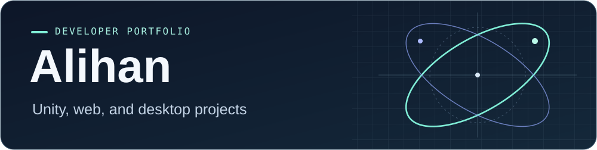
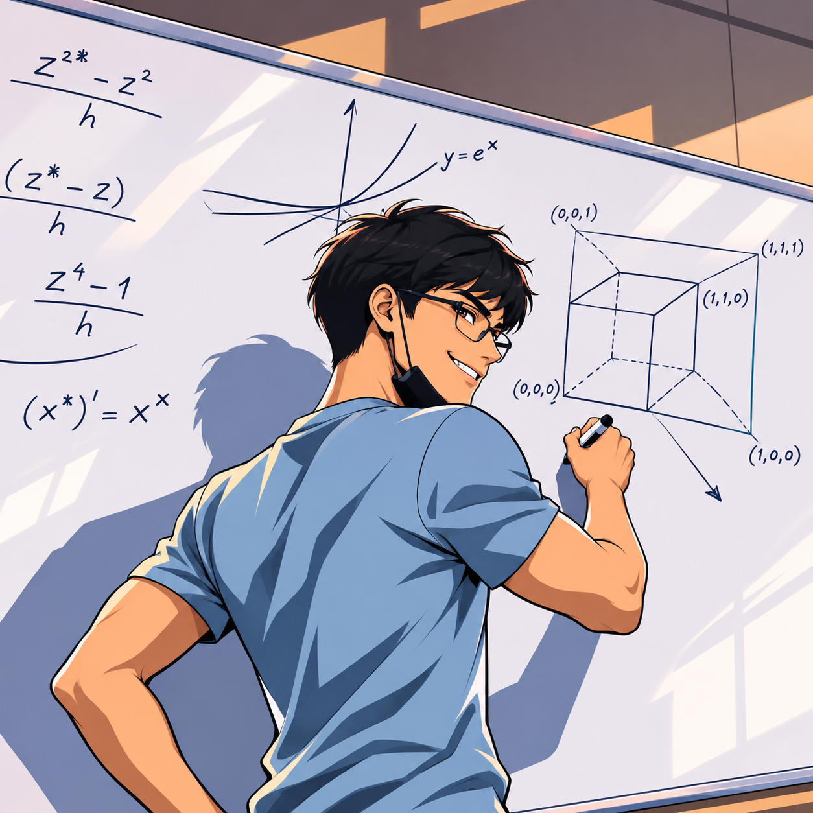
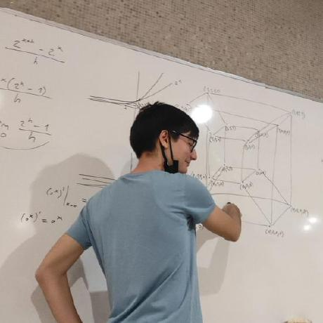

I'm a software developer focused on web applications and Unity games. I graduated from Bilkent University with a degree in Mathematics and completed a minor in Software Development with a 4.00 GPA.

## Selected projects

| Project | What it does |
| --- | --- |
| [Unity Spin Game](https://github.com/alihansrm/unity-spingame) | Android reward-wheel prototype with three wheel tiers, a risk mechanic, and a responsive Unity UI. **Unity · C#** |
| [Arcade Car Controller Docs](https://github.com/alihansrm/bootstrap-unity-arcadecardocs) | Turkish tutorial covering raycast suspension, car handling, camera setup, and effects in Unity 6. **Unity · C# · HTML · CSS · Bootstrap** |
| [PHP E-Commerce App](https://github.com/alihansrm/php-ecommerce-app) | Course project with customer and seller accounts, a product catalog, and a shopping cart. **PHP · MySQL · JavaScript** |
| [MyScriptorium](https://github.com/alihansrm/java-scriptorium) | Desktop catalog for books, DVDs, and magazines, with sorting and search by ID. **Java · Swing** |
| [ETHIstanbul Landing Page](https://github.com/alihansrm/web-ethistanbul) | Responsive conference page with speaker cards, a schedule, and merchandise previews. **HTML · CSS** |

## More work

Browse my [Unity experiments](https://github.com/alihansrm/Unity-Projects) and [Obsidian notes](https://github.com/alihansrm/learn-obsidian).

## The reality behind my profile picture :)

| AI version | Original |
| :---: | :---: |
|  |  |
